# Harf Atölyesi | Letter Workshop

Türkçe ve İngilizce kelime oyunu. **13 × 13** tahtada tek başına çalışın, tarayıcıda yerel rakiple oynayın veya Node sunucusu üzerinden gerçek oyuncularla düello yapın.

| Ana menü | Tekil antrenman | Düello |
| --- | --- | --- |
| 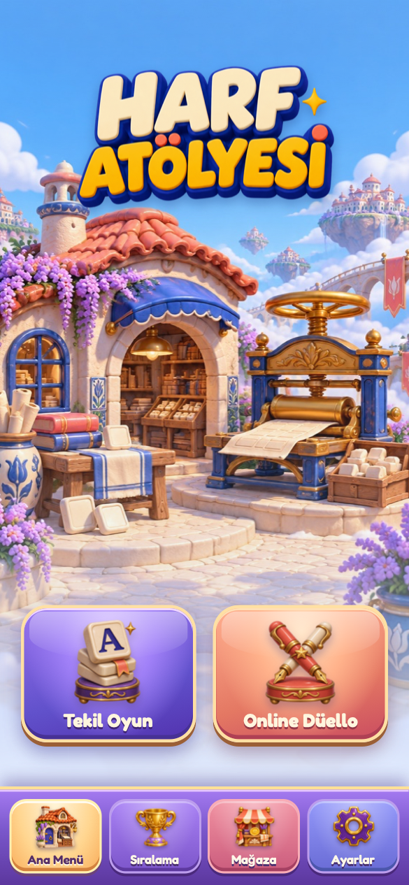 | 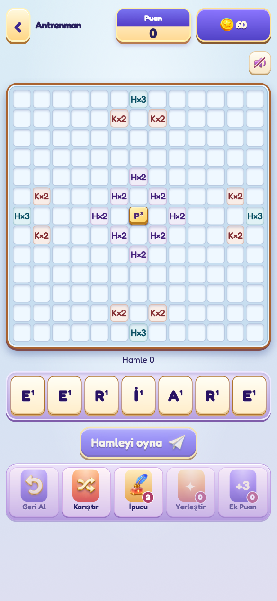 | 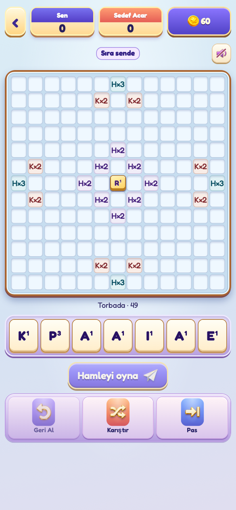 |

## Teslim ve dokümantasyon

| Teslim | Kullanım |
| --- | --- |
| [Oyun Tasarım Dokümanı](docs/Harf-Atolyesi-GDD.pdf) | Ekranlarla oyun kuralları, akışlar, ses, ödüller ve platformlar |
| [Teknik mimari](docs/Harf-Atolyesi-Teknik.pdf) | Uygulama yapısı, işlem diyagramları, API, SQLite, mobil derleme ve kod örnekleri |
| [Standalone HTML](builds/Harf-Atolyesi-Standalone.html) | Dosyayı indirip tarayıcıda açın. Tekil oyun ve yerel düello çalışır. |
| [Android APK](builds/Harf-Atolyesi-Android-Test.apk) | Yerel test imzalı Android 8.0 ve üzeri APK |
| [Huawei APK](builds/Harf-Atolyesi-Huawei-Test.apk) | GMS bağımlılığı bulunmayan aynı Android test paketi |
| [iOS cihaz IPA](builds/Harf-Atolyesi-iOS-Unsigned.ipa) | arm64, iOS ve iPadOS 16+. Yükleme için uygun imza ve provisioning gerekir. |
| [iOS simülatör ZIP](builds/Harf-Atolyesi-iOS-Simulator.zip) | Apple Silicon simülatöründe yerel test arşivi |
| [Facebook Games ZIP](builds/Harf-Atolyesi-Facebook-Games.zip) | Meta Instant Games başlatma köprüsü içeren paket. Platform panelindeki yerel test ve onay gerektirir. |
| [Sözlük SQLite](game/harf-atolyesi-kelime-sozlugu.sqlite3) | Türkçe ve İngilizce sözlük verisi ve kaynak notları |

## Oyun özellikleri

- **Tekil antrenman** ana menüden doğrudan başlar. Puan eşiği ve bölüm sistemi yoktur. Her geçerli hamle puana eklenir, oynanan taşların yeri doldurulur. Tahta dolduğunda sonuç açılır. Eldeki harflerle hamle yoksa yeni taş çekme ve bitirme seçenekleri sunulur.
- **Düello** sıra tabanlıdır. Sunuculu sürümde aynı dilde eşleşme, pas, çekilme, maç süresi ve Elo uygulanır. Uzun beklemede derecesiz bilgisayar antrenmanı devreye girebilir.
- **Hamle motoru** bağlantı ve doğrultuyu kontrol eder. Oluşan bütün kelimeleri seçilen dilde doğrular. Yeni taşlar için H×2, H×3 ve K×2 çarpanları uygulanır.
- **Mağaza** tekil altınla İpucu, Yerleştir ve Ek Puan sunar. Yerel mağaza bakiyesi ve çevrimiçi cüzdan ayrı saklanır. Gerçek para satın alması bağlı değildir.
- **Ses ve hareket** Tile Layers metalik altın kaydını, kullanıcı tarafından sağlanan oyun müziğini ve Higgsfield piyanosunu içerir. Müzik seçimi Oyun Müziği, Piyano veya Kapalıdır. Kare ses düğmesi oyunun içinden genel sesi yönetir.
- **Hesap** kayıt, giriş, çıkış, görünen ad güncelleme, parola değiştirme ve hesap silme destekler. E-posta ile parola sıfırlama bağlı değildir.

| Hamle ve altın | Mağaza | Ayarlar |
| --- | --- | --- |
| 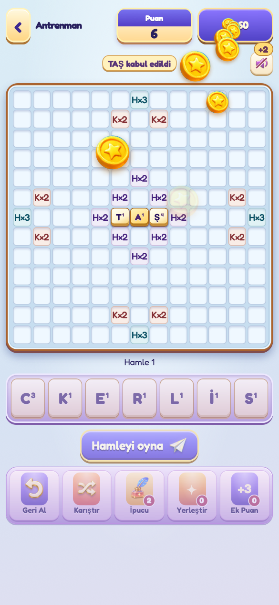 | 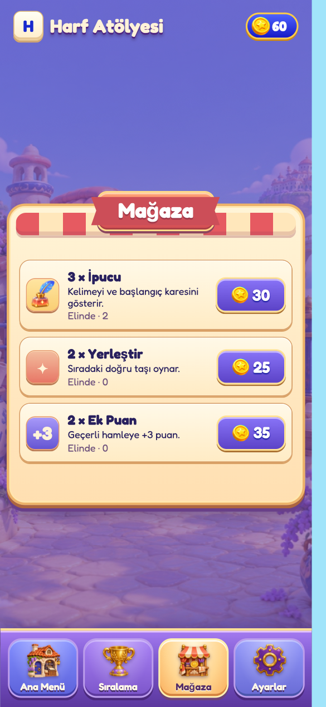 | 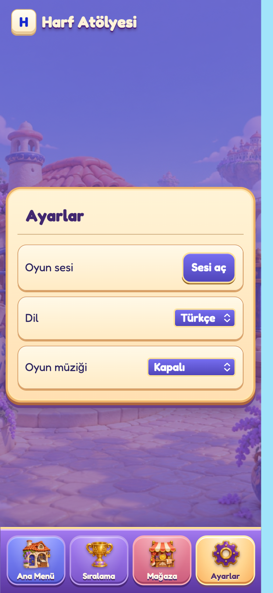 |

| Eşleşme | Yerel sıralama | Antrenman sonucu |
| --- | --- | --- |
| 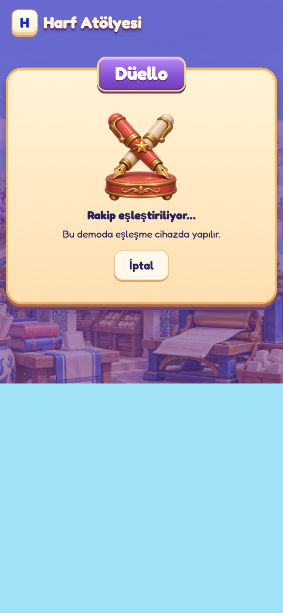 | 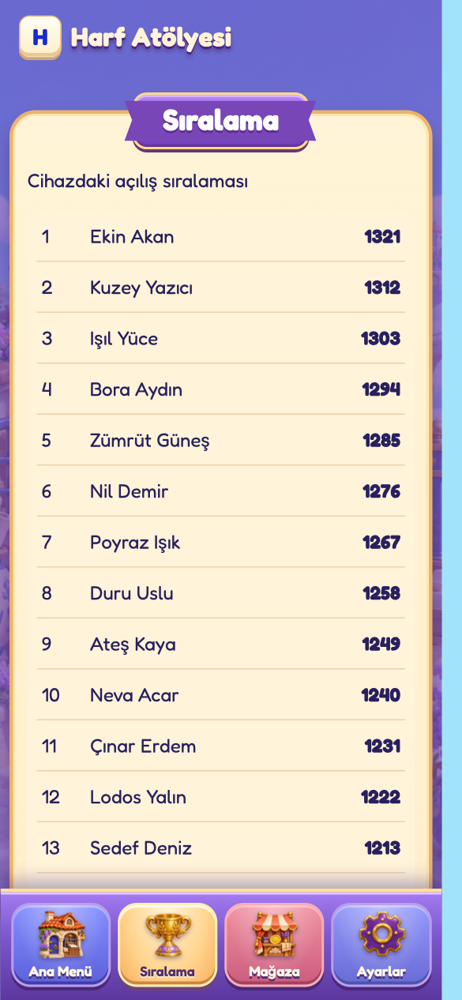 | 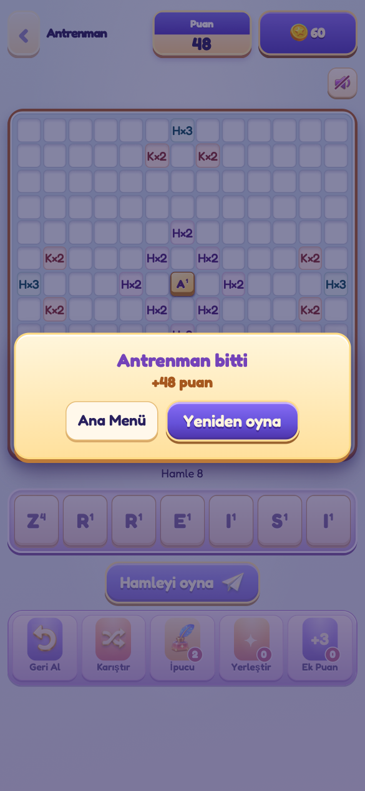 |

## Ekran uyumluluğu

Tahta, raf ve kumandalar genişliğe, dinamik ekran yüksekliğine ve güvenli alanlara uyarlanır. Kısa yatay görünümde raf ve kumandalar sağ sütuna geçer. Kısa veya çok dar portre ekranında sayfa dikey kayabilir. Tahta 169 karenin tamamını yatay kaydırma olmadan gösterir.

| Kısa telefon | Dar kapak ekranı | Açık katlanabilir benzetimi | Tablet |
| --- | --- | --- | --- |
| 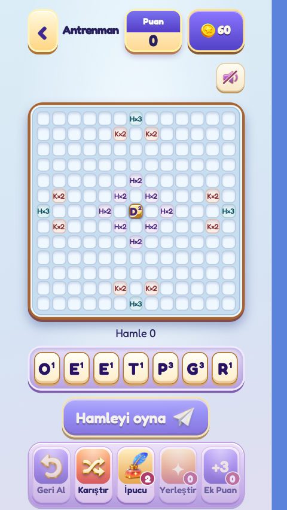 | 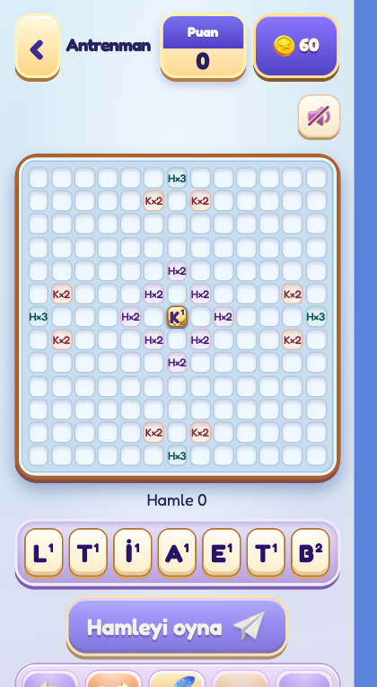 | 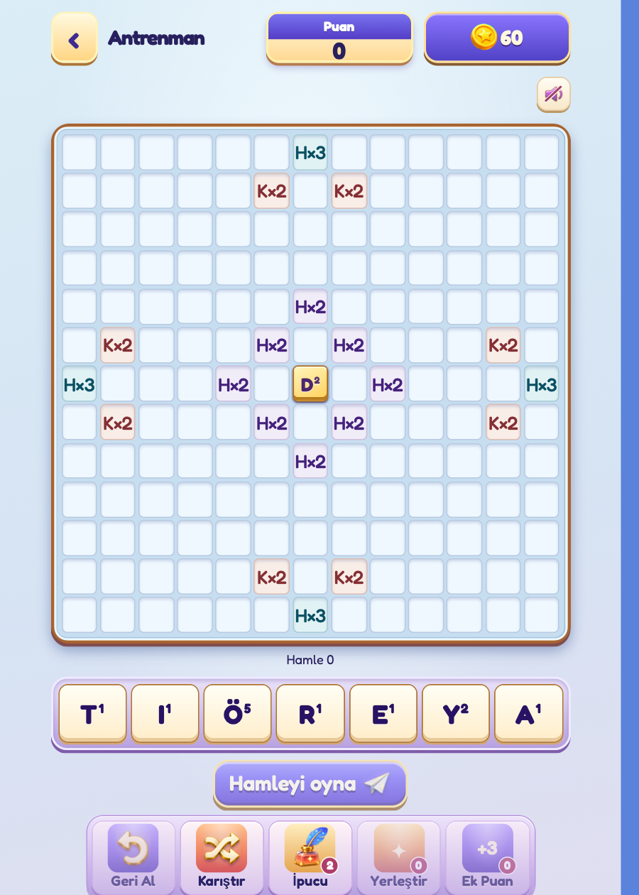 | 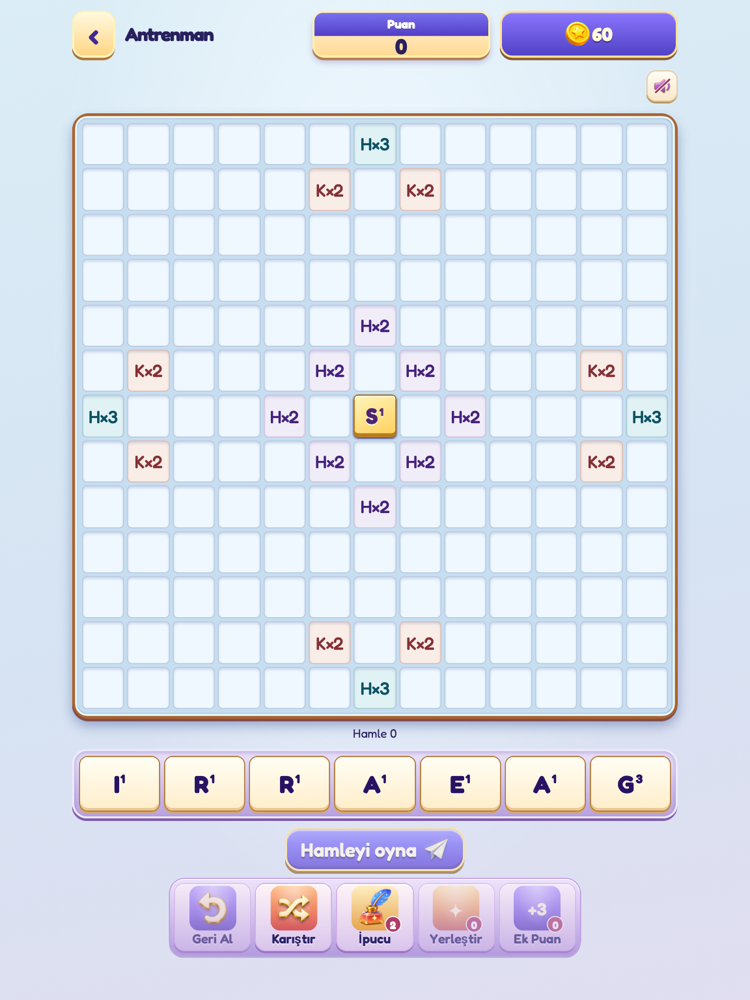 |

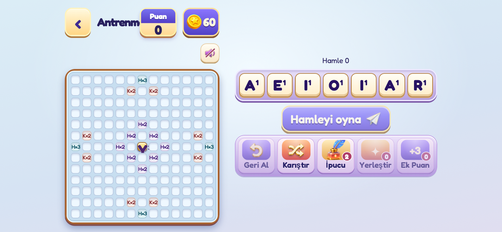

WebKit ölçüm setinde **280 × 510**, **320 × 568**, **390 × 844**, **430 × 932**, **600 × 840**, **768 × 1024**, **844 × 390** ve **1366 × 768** görünüm alanları yer alır. [Ölçüm çıktısı](qa/layout.json) · [Tüm ekran görüntüleri](docs/screens/)

## Yerel çalıştırma

Node.js 24+ gerekir. Sunucu yerleşik HTTP ve SQLite modüllerini kullanır.

```sh
cd game
DATA_DIR=../game-data node server.cjs
```

Tarayıcıdan [127.0.0.1:8787](http://127.0.0.1:8787/) adresini açın. Çevrimiçi akışı aynı dilde iki ayrı tarayıcı profili ve iki hesapla deneyin. Uygulama internete yayımlanacaksa [sunucu kılavuzundaki](game/SUNUCU.md) HTTPS, güvenli çerez ve yedekleme ayarlarını uygulayın. Gerçek kullanıcı verisi için ayrı bir `DATA_DIR` kullanın.

| Katman | Sorumluluk |
| --- | --- |
| [app.js](game/app.js), [style.css](game/style.css) | Ekranlar, tekil akış, arayüz, animasyon ve responsive düzen |
| [engine.js](game/engine.js), [dictionary.js](game/dictionary.js), [duel-rules.js](game/duel-rules.js) | Tahta, kelime doğrulama, puan, yasal hamle arama ve açılış |
| [audio.js](game/audio.js) | Efektler, tek etkin müzik kaynağı, ses ve yaşam döngüsü |
| [online.js](game/online.js) | Hesap formu, sıra istekleri, durum yenileme ve liderlik arayüzü |
| [server.cjs](game/server.cjs) | HTTP, parola ve oturum, eşleşme, yetkili hamle işlemi ve SQLite |
| [mobile/](mobile/) | Android Activity ve iOS UIKit/WKWebView uygulaması |
| [scripts/](scripts/) | Tek dosyalı web, Facebook, Android, iOS, ekran ölçümü ve PDF üretimi |

Canlı akışta istemci hamleyi `POST /api/move` ile gönderir. Sunucu oturumu, sırayı, sürümü ve raf slotlarını kontrol eder. Skoru kendi motoruyla hesaplayıp bir işlem içinde kaydeder. Bu sürüm tek Node süreci ve SQLite kullanır.

## Paketleri yeniden üretme

Komutları depo kökünde çalıştırın.

```sh
python3 scripts/package-standalone.py
python3 scripts/package-facebook.py
ANDROID_SDK_ROOT=/path/to/android-sdk JAVA_HOME=/path/to/jdk-21 scripts/build-android.sh
scripts/build-ios.sh iphoneos
scripts/build-ios.sh iphonesimulator
```

Android derlemesi Android SDK 36, Build Tools 36.0.0 ve JDK 21 kullanır. APK yerel test anahtarıyla imzalanır. Gizli anahtar depoya eklenmez. iOS derlemeleri Xcode gerektirir. Android ve iOS için derleme sırasında `GAME_URL=https://oyun.example` verilebilir. URL boşsa paketteki tekil oyun ve yerel düello açılır. Facebook paketindeki SDK köprüsü yerel test içindir. Gerçek eşleşme, Meta uygulama ayarları ve canlı HTTPS sunucusu bağlandıktan sonra ayrıca doğrulanmalıdır.

## Doğrulama

```sh
node game/tests/verify-engine.cjs
node game/tests/verify-server.cjs
```

Motor testi bağımsız yerleşim karşılaştırması, geçersiz hamleler ve iki dilde kelime kesişimlerini kapsar. Sunucu testi geçici bir SQLite veritabanı ve iki test hesabıyla oturum, maç, puan ve sıralama akışını çalıştırır. Fiziksel Huawei/Fold cihazları, mağaza onayı, gerçek ödeme ve yayındaki Meta oturumu için ayrıca kabul testi gerekir.

## Varlık ve veri notları

Oyun çizimleri, ikonlar, müzikler, metalik altın kaydı, sözlük ve yazı tipi paket içindedir. [Ses kaynakları](game/Audio-notices.txt) · [Sözlük kaynakları ve lisanslar](game/Dictionary-notices.txt) · [Fredoka lisansı](game/Fredoka-OFL.txt)

Depo, canlı hesap verisi, oturum çerezi, imza anahtarı veya provisioning profili içermez.
